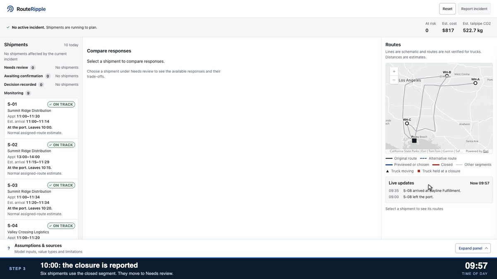
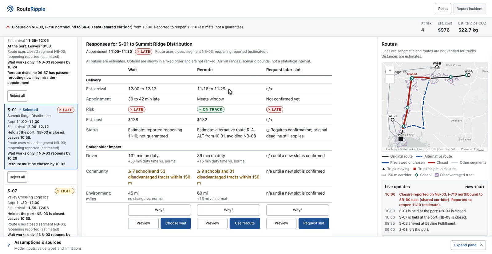
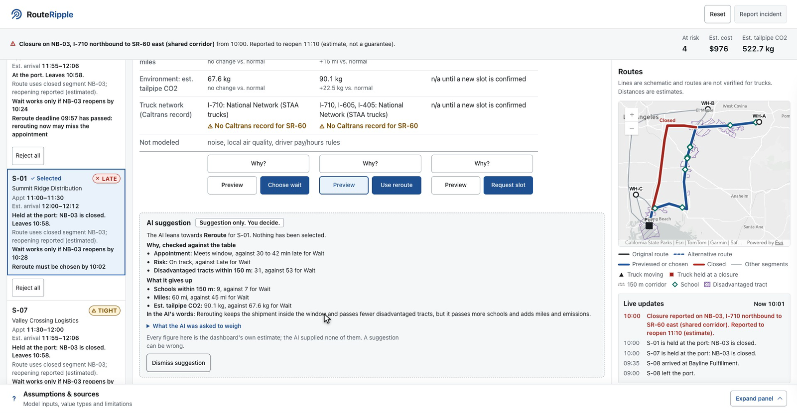
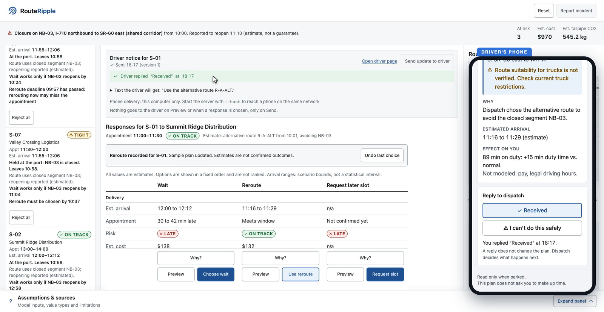
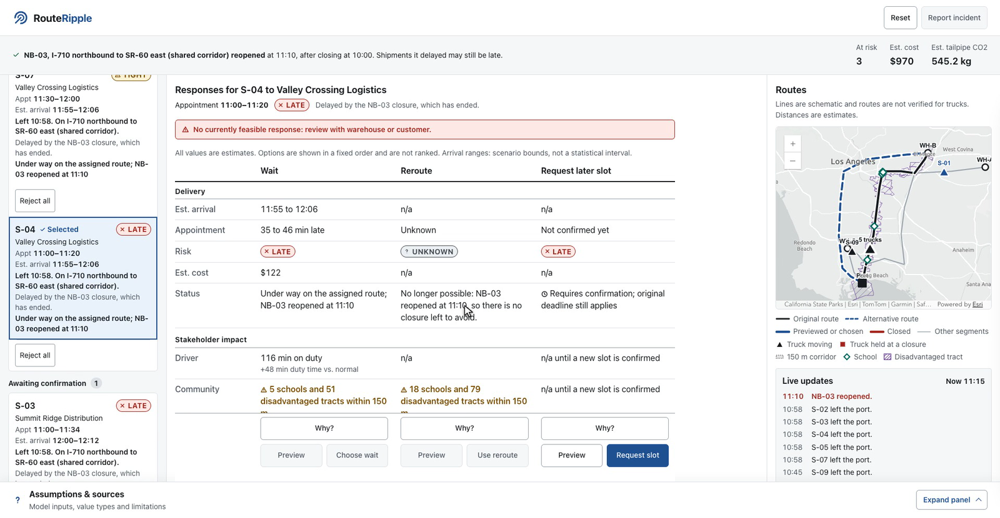
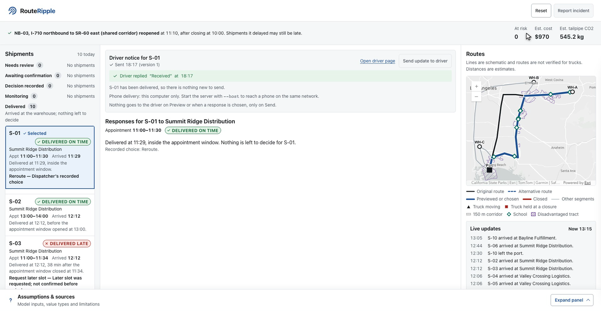

# RouteRipple

AI-assisted disruption triage dashboard for port-to-warehouse deliveries.
Stack: Vite + React + TypeScript, Vitest, ESLint, plain CSS.

## Demo

[](https://github.com/arturoidelgado1998/Hackathon2026/releases/download/demo-video/RouteRipple-demo-3min.mp4)

**[Watch the full 3-minute demo](https://github.com/arturoidelgado1998/Hackathon2026/releases/download/demo-video/RouteRipple-demo-3min.mp4)** (MP4, 11 MB, no audio). The clip above is a 22-second cut of it.

A road out of the Port of Long Beach closes at 10:00. RouteRipple shows the
dispatcher which shipments it delays, what each response would cost, and who
else it affects. The dispatcher decides, the driver is told, and the dashboard
follows the day until every load is delivered.

| | |
|---|---|
|  |  |
| **Compare responses side by side.** Wait, reroute or request a later slot, with arrival, cost, driver time, CO2, and the schools and disadvantaged neighbourhoods each route passes. Nothing is ranked. | **Ask the AI for a suggestion.** It sees only the figures in the table. The dashboard checks every reason it gives against those figures and lists what the suggestion gives up. It selects nothing. |
|  |  |
| **Tell the driver, and hear back.** Nothing reaches the driver until Send. The driver can acknowledge or flag a concern; the decision stays with dispatch. (The phone frame was added for the video; the page inside it is the real driver page.) | **The dashboard follows the clock.** Once the road reopens or a truck has passed the turn-off, the responses that no longer apply are closed and say why. |
|  | |
| **Delivered loads ask for nothing more.** Each card says when it arrived and whether it met its appointment. | |

What is real and what is not: the shipments, routes, travel times and the
closure are simulated. The schools and disadvantaged-community tracts along
each route are real public data, and the cost and CO2 inputs are published
trucking figures; see the **Assumptions & sources** panel in the app and
[`src/data/README.md`](src/data/README.md).

What is underneath:

- **One engine** computes every arrival, lateness, cost and CO2 figure. The
  interface and the AI never recompute them.
- **The AI is boxed in.** Its answer is refused whole unless every reason it
  gives is true in the figures, and its key stays on the server.
- **650 unit tests and 57 browser checks** run on every pull request, along
  with a live check of the AI on its test reports.

## Brand

The approved **Route Node** mark and RouteRipple wordmark appear in the dashboard,
the mobile driver notice at `/driver.html#S-01` and the truck simulation at
`/simulation.html`. All three pages use the same
[SVG logo](public/routeripple.svg), browser icon and
[180px Apple touch icon](public/apple-touch-icon.png).
The shared component is [`Brand`](src/components/brand/Brand.tsx).

The original [three-concept comparison](logos/preview.html) is available at
`http://localhost:5173/logos/preview.html` while the dev server runs.
The project-scoped [SVG logo skill](.github/skills/svg-logo-skill/SKILL.md) comes
from [longcipher/svg-logo-skill](https://github.com/longcipher/svg-logo-skill/tree/b86e71f093dc6b4d8f79dedd1a41445181c79c88),
under its included Apache-2.0 license. Reload the coding tool if the new skill
does not appear. It adds no application dependencies.

RouteRipple was previously named PortPlan. Existing driver notice/reply storage
keys, relay identifiers and ArcGIS service URLs intentionally retain their old
names for compatibility. Historical changelog entries are preserved.

## Prerequisites

Node 24 and npm 11. Check `node --version` and `npm --version` before installing.
If Node is installed in your user-local directory, add it to each shell:

```sh
export PATH="$HOME/.local/node/bin:$PATH"
```

## Commands

```sh
npm install         # install dependencies
npm run dev         # start the dev server (http://localhost:5173)
npm test            # run the test suite once (Vitest)
npm run build       # type-check and build to dist/
npm run typecheck   # type-check only
npm run lint        # ESLint
npm run evaluate    # Node 24: regenerate SIMULATED docs/evaluation.csv + .json
npm run sanity      # build, then run the sanity checks (see below)
npm run server      # start the incident server for the AI step (http://127.0.0.1:8787)
npm run ai:tests    # ask the real model the five test reports and record its answers
```

## Sanity checks

`npm run sanity` builds the app and checks that the project as a whole still works. The checks live in `sanity/` and also run on every pull request (the "Sanity checks on the built app" job).

- **Repository:** the scripts the README and the pipeline call exist, the layout below is in place, and no `.env` file, key or build output is checked in.
- **Change log:** `docs/changelog.json` adds up, refers only to issues that exist, and every file it says was built is still there.
- **Build:** the page and its files are complete, and the ArcGIS map stays out of the first page load.
- **Data:** the files in `src/data` agree with each other and with the scripts that write them. The corridor analysis matches the segment lines it was run on, the counts in `routes.json` are the stored analysis, the map's layers hold exactly the places counted, every real layer has its source and date, and nothing says a route is legal or safe for trucks.
- **Browser:** the built app is opened in headless Chromium and taken through the main flow: start, closure, compare responses, every shipment, reset, and the real map. It also checks that the community counts match between the comparison table, the map panel and the places drawn on the map, and that the truck network row stays a record.
- **Incident server:** `node server/index.ts` is started as a real process, with the AI switched off and with a stand-in model, and a report is followed through it. No real model or key is used.
- **Pipeline:** the workflow still runs lint, typecheck, tests, build and these checks on pull requests into `staging` and `main`, and no sanity file is skipped because of its name.

The browser check needs Chromium once per machine: `npx playwright install --only-shell chromium`. The data checks need `python3` (3.9 or later, standard library only) and never use the network. Use `npm run test:sanity` to rerun the checks without rebuilding.

## Live dashboard and simulation page

The dashboard at `/` is fed live and has no simulation controls or wording. The
run is set up and started on a separate page, `/simulation.html`, which stands in
for a live data feed.

- **Before a run starts** the dashboard shows only the day's schedule: each
  shipment's destination, appointment and cargo-ready time. There are no arrival
  estimates, risk, closure, trucks or totals, and nothing can be selected.
- **On the simulation page** choose a normal day or a road closure (segment,
  closing and reopening times), then press **Start simulation**. Play, pause,
  restart, the time slider and the speed are all there. **Link to this setup**
  holds the settings, so a teammate who opens it gets the same setup.
- **Once the run starts** the dashboard fills in: estimates and risk appear,
  trucks move on the map, each card says where its truck is, and **Live updates**
  under the map lists what has happened. A closure is reported when its start
  time is reached, not before, and the road is drawn open again once it reopens.
- **The dispatcher still makes every choice.** Choosing **Use reroute** moves that
  truck onto the alternative route. The simulation never chooses a response.
- **The dashboard follows the clock.** What a card offers depends on where its
  truck is now, not only on the day as planned:
  - A load that has reached its warehouse moves to **Delivered** with what
    happened ("Delivered at 12:12, 42 min after the appointment window closed at
    11:30"). It offers no responses, and it no longer counts as at risk.
  - **Reroute closes** once the road has reopened, or once the truck has entered
    a segment the alternative route does not have. A truck still at the port, on
    a segment both routes share, or queued at the closed segment can still be
    rerouted. A closed response keeps its column in the comparison and says why.
  - **A reroute is timed from where the truck is.** For a truck held at the port
    or queued at the closure, the estimate starts at the current minute, so it
    gets later the longer the choice is left, and the card says when the reroute
    deadline has passed. The truck then leaves from where it stands: choosing
    late never moves it back in time.
  - **Wait closes** once the road has reopened (the truck is simply on its way)
    or once the truck is on the alternative route. **Request later slot** stays
    open until delivery.
  - **Undo** is offered only while taking the choice back would not move the
    truck. After that the panel says why it cannot be undone.
  - A previewed response that closes is dropped. If the clock is moved back,
    choices made after the new time are forgotten and delivered loads return.
  - Once the road has reopened, an affected load that is on track goes back to
    Monitoring; one that is late or tight stays in Needs review, because a later
    slot can still be requested.

  The rules are in `src/sim/liveAssessment.ts`; every arrival, lateness, cost and
  CO2 figure in them comes from the engine. The prefilled sample has no clock, so
  none of this applies there.
- **Trucks and closures.** A truck that is not yet on the road when a closure
  starts is held at the port and leaves in time to reach the segment as it
  reopens. A truck already on the road queues at the closed segment. The
  engine's arrivals, cost and CO2 are the same either way.
- **Other devices.** The page and the dashboard talk through a relay on the app's
  own server (`/api/sim-state`, in `server/simRelay.ts`), mounted by the dev server
  and by Vite's preview server. Start it with `npm run dev -- --host` so a teammate
  on the same network can open the simulation page. Without the relay, for example on a
  static copy of the build, only tabs in the same browser follow each other.
  DEMO ONLY: there is no sign-in. Opening the simulation page sends nothing; the
  dashboards follow whichever page last had something changed on it, and a second
  running page cannot pull them away.
- **Who can reach it.** Started with `--host`, the server is on the network, so
  it has a gate (`server/access.ts`):
  - This computer needs nothing.
  - Another device must send the server's access key. A new key is made each
    time the server starts, and it is already in the links the pages show: the
    simulation page's **Link to this setup** and the dashboard's driver address
    (`…/driver.html?k=…#S-01`). Without it the relays answer 401; the pages
    themselves still load. Set `RELAY_KEY` in `.env` to keep one key across restarts.
  - The AI never leaves this computer. `/incident` and `/shipment` are refused
    (403) for every other device, with or without the key, because each call
    spends the model key. The AI server also makes at most 30 model calls a
    minute (`AI_MAX_PER_MINUTE`) and answers 429 past that.

  The key is a shared passcode in a link. It keeps a stranger on the same
  Wi-Fi out; it is not a sign-in, and it travels over plain HTTP.
- **The prefilled sample** described below is still available at `/?sample`. The
  browser sanity checks use it.

All positions and times are SIMULATED and come from the engine. Trucks follow
the schematic segment lines, not real roads.

## Sample dashboard workflow

This is the prefilled sample at `/?sample`.

- The dashboard starts in **Disrupted**, showing the simulated NB-03 closure. Select a
  shipment under **Needs review** to compare responses. **Normal** remains available.
- A first-use prompt explains this path in the Normal scenario. On small screens,
  empty board groups are collapsed behind **Show empty groups**; select a shipment and
  use **View responses** to jump to its comparison, or **Back to shipments** to return.
- **Preview** highlights an option's route without changing decisions or totals.
  A **Preview only** notice distinguishes it from the recorded choice; **Cancel preview**
  returns to the current plan.
- **Choose wait** or **Use reroute** records the response and shows a confirmation.
  **Request slot** records a simulated request that stays **Awaiting confirmation**,
  retaining the shipment's original risk and current-plan totals.
- Before a slot is requested, its status is **Requires confirmation**, not pending.
- **Undo last choice** reverses the most recent response choice, restoring the prior
  decision or Needs review state, any prior rejection note, routes, risk and totals.
  Other shipments are unchanged. Undo is one step, not a decision history or an external
  cancellation; switching scenarios or Reset clears it.
- **Reject all** keeps a shipment in Needs review with the dispatcher's rejection note.
- Cards, response estimates, explanations and `getTotals(state)` use the pure engine
  against the current raw shipment, segment and assumption inputs, never the generated
  response fixture. Switching scenarios clears scenario-specific decisions.
- Every affected card shows available estimated reopen/reroute decision deadlines.
  Needs review sorts by earliest reroute deadline, missing deadlines after known ones,
  and shipments with no currently feasible response last (including S-03, not TIGHT S-04).
  Equal deadlines use shipment ID. This is shipment urgency, not response ranking.
- **Reset** restores the initial Disrupted scenario with no decisions or selected shipment,
  collapses empty groups, and clears preview and Undo state.
- **Why?** opens and focuses the option's supplied explanation inputs. Use **Close**
  or Escape to return focus to its Why button. **Assumptions & sources**
  lists the cost and CO2 inputs with their published sources, value-type labels and the twelve limitations from
  issue #9. Use **Expand panel** in the bottom bar to read the full, scrollable panel;
  collapse it or press Escape to return to the dashboard. On mobile the bar stays within
  reach at the bottom of the screen. Reset also closes the panel. The reusable limitations
  text lives in `src/data/limitations.ts`.

### Accessibility and degraded states

- Normal operations show **No shipments affected by the current incident**. With no
  selection, the comparison prompts for a shipment; an affected shipment without a
  feasible response retains the warehouse/customer review warning.
- `App` accepts an optional `incidentInterpretationStatus` prop: `'idle'` (default),
  `'loading'`, or `'unavailable'`. These presentation-only sample/integration states
  announce **Interpreting incident…** or **AI unavailable: use manual entry**, without
  clearing selection, preview, decisions or totals. `AIUnavailableBanner` is reusable
  by the future incident-entry flow. This does not implement A2, a request endpoint,
  or a manual-entry form; **Report incident** remains disabled.
- `src/App.accessibility.test.tsx` uses `vitest-axe` on the main dashboard, comparison,
  explanations, empty and degraded states, asserting no serious/critical violations.
  The ArcGIS canvas is replaced by the existing test stand-in. jsdom cannot compute
  layout/color contrast; the axe color-contrast rule is explicitly disabled there.
  Browser contrast and keyboard checks remain separate from this automated DOM check.
- `npm run test:sanity -- sanity/accessibility.sanity.test.ts` runs the focused
  Chromium keyboard, responsive and computed-contrast checks against a local source
  server (no build required). Contrast is measured at desktop width: axe cannot
  measure partially clipped mobile table cells. It isolates the ArcGIS map/network
  like the existing dashboard browser checks. Physical-device and screen-reader
  testing are still manual.

### Reproducible evaluation

From a clean checkout with Node 24 and npm 11, run `npm run evaluate` (no install,
build, Vite loader, network data or response fixture required). It regenerates
[`docs/evaluation.csv`](docs/evaluation.csv) and
[`docs/evaluation.json`](docs/evaluation.json) from raw JSON inputs and the typed
SIMULATED incident in `src/data/demoIncident.ts`.

Both exports contain all nine engine rows with units, estimation/SIMULATED labels,
row rules and deterministic selection metadata, comparing **Normal**, **Disrupted —
no action** and **Disrupted — selected responses**. JSON preserves the engine row
shape; CSV flattens the three scenario values and includes simulation metadata
(nested metadata uses quoted JSON fields). Unknown estimates are `null`, never zero.
The evaluation-only rule chooses an available ON_TRACK driving response with the
fewest added miles (Wait wins ties), or requests a later slot while retaining
current Wait metrics. It never auto-selects or ranks responses in the app.

## Impeccable design skill

The project-scoped GitHub Copilot skill is installed in `.github/skills/impeccable/`.
Reload your coding tool if `/impeccable` does not appear. This dashboard uses the
existing restrained design system; the skill's polish guidance is not a redesign.
Telemetry is disabled in `.impeccable/config.json`. Automatic hooks are not enabled;
run the local detector explicitly after UI changes:

```sh
.github/skills/impeccable/scripts/impeccable detect --json src/
```

The launcher downloads its checksum-verified, platform-specific engine on first use
when necessary. Engine binaries are not committed. The install adds no application
dependencies and does not send source files to Impeccable.

## Environment

Copy `.env.example` to `.env` and fill in values locally. Never commit `.env`.
The LLM key is server-side only (`server/`); only `VITE_`-prefixed variables reach the browser.

## AI incident interpretation

The dispatcher pastes an incident report; the AI reads it and returns which segment it names, whether it is a closure, the stated time to reopening, and the exact words it relied on. That is all it does. It calculates nothing, it cannot add a segment or a route, and nothing changes until the dispatcher confirms.

- **Providers:** two are supported, chosen by `LLM_PROVIDER` in `.env`.
  - **AI Squared's Bolt** (`bolt-instruct-v2`), through an OpenAI-compatible endpoint, with a plain HTTPS request. Set `LLM_BASE_URL`, `LLM_MODEL` and `LLM_API_KEY`.
  - **The Claude API**, through Anthropic's official SDK (`@anthropic-ai/sdk`, the one dependency this adds; it is used by the server only). Set `LLM_PROVIDER=anthropic` and `ANTHROPIC_API_KEY`; `ANTHROPIC_MODEL` is optional and defaults to `claude-opus-5-5`. Claude answers through structured outputs, and if it declines a request for a policy reason the API retries on its default fallback model.
  - The two sets of variables are separate, so both can sit in `.env` and switching is one line. The Bolt key is never sent to Claude, or the other way round.
- **Setup:** copy `.env.example` to `.env` and fill it in. Edit the file in an editor; do not put a key on a command line.
- **Comparing models:** `npm run ai:tests -- --check --models=claude-opus-5-5,claude-sonnet-5-5,claude-haiku-5-5` asks each model the same eight questions and prints how many it got right, how long it took and an estimated cost.
- **Run:** `npm run server` in one terminal and `npm run dev` in another. The dev server forwards `/incident` to the incident server, so the browser never talks to the model and never sees the key. Only this computer's browser is forwarded: started with `--host`, other devices get the pages but not the AI.
- **Pipeline:** the live AI check reads `LLM_API_KEY` and `LLM_BASE_URL` from repository secrets, so both are masked in the run's log; `LLM_MODEL` and `LLM_PROVIDER` are plain variables.
- **Without a key, or without a route to the model**, the server still starts and answers with a clear error. The manual-entry path (A2) is for exactly that.

`POST /incident/interpret` takes `{ "report": "..." }` (up to 2,000 characters) and answers:

| Status | Body | Meaning |
| --- | --- | --- |
| 200 | `{ "interpretation": { ... } }` | A reading that passed every check |
| 400, 413 | `{ "error": "bad_request", ... }` | No report, not JSON, or too long |
| 422 | `{ "error": "invalid_model_response", "details": [...] }` | The model's answer failed a check and was discarded whole |
| 502 | `{ "error": "model_unreachable" }` or `"model_rejected"` | The model could not be reached, or refused the request |
| 503 | `{ "error": "not_configured" }` | The server has no model settings |

**What the model is sent:** the report text, the id and name of each segment, and the six-field answer format. No shipments, routes, times, costs or personal data.

**What is checked before a reading is returned** (`src/incident/interpretation.ts`): the segment exists in `segments.json`; the type is `closure` or `unsupported`; the duration is a number or absent; the evidence is an exact quote from the report; there are no extra fields; and a closure with no segment is sent back as a question, never guessed.

**Test record:** [`docs/ai-tests.md`](docs/ai-tests.md) lists the five SYNTHETIC test reports with expected and actual readings, and the AI's suggestions for three simulated shipments. On GitHub the "Live AI check" job asks the real model the same questions, using the `LLM_API_KEY` repository secret.

## AI suggestion

Below the comparison table the dispatcher can ask the AI which response it would lean towards for the selected shipment. It is a suggestion, not a decision.

- **Asked for, never shown unasked.** Nothing is sent to the model until the dispatcher clicks "Ask the AI for a suggestion".
- **It selects nothing.** No option is pre-selected or highlighted, and no card, total or map changes. The Preview and Choose buttons work exactly as they do without it.
- **The AI supplies no figures.** It is given the figures the table already shows and returns an option, up to three measures it rests on, and one sentence with no numbers. The dashboard prints every figure from its own data.
- **A reason must be true.** A suggestion is discarded whole if a measure it cites is not actually better for that option.
- **What it gives up is always shown, in full.** The dashboard works that out itself from the figures, so the AI cannot leave a downside out.
- **What the AI was asked to weigh is shown word for word**, and lives in one place: `WEIGHING` in `src/suggestion/suggestion.ts`. It is a value choice the team should review.

`POST /shipment/suggest` takes `{ "facts": { ... } }` (the option figures for one shipment) and answers with `{ "suggestion": { ... } }` or the same errors as the endpoint above.

**This changes a project rule.** The tracker's rule 4 says "No single best option, ranking or ethics score anywhere". The comparison table still ranks and scores nothing, and the words "best" and "recommended" are still never shown, but an AI suggestion now exists. The repository owner decided this on 2026-11-14; the tracker issue's text has not been edited.

**Network note:** on 2026-11-14 the venue network blocked the model's address, so calls from a laptop on that network fail with `model_unreachable`. A phone hotspot and GitHub's runners are outside it.

## Layout

- `src/types.ts`: shared entity types used across the app
- `src/engine/`: pure TypeScript calculation engine (no UI, no network)
- `src/data/`: JSON sample data, the corridor analysis results, and `real/` reference data from Caltrans
- `scripts/`: Python scripts that rebuild `src/data` (standard library only)
- `src/components/`: React components
- `src/map/`: map panel
- `src/sim/`: truck simulation, the simulation page and the live link to the dashboard
- `src/state/`: app state
- `server/`: small Node endpoint for the LLM call, and the relays the dev server mounts (driver notices, simulation)
- `src/incident/`: what the AI may return, and the check every answer must pass
- `sanity/`: sanity checks on the repository, the change log, the build and the built app
- `docs/`: project documentation

## Map

The Routes pane draws the port, warehouses and routes with the ArcGIS Maps SDK for JavaScript (`src/map/ArcgisMap.tsx`). It is loaded on demand, and if it cannot load the pane falls back to the route list.

- **No API key is needed.** Without one the map uses Esri's keyless light gray basemap.
- **Optional key:** put `VITE_ARCGIS_API_KEY=...` in a local `.env` (never commit it) to use the `arcgis/light-gray` basemap style.
- **Data:** the map draws the same data as the rest of the app, from `src/data`. Refresh it from the team's feature service with `python3 scripts/import_map_data.py`.
- **Community layers:** for the selected shipment's route (the previewed or chosen one, otherwise the original) the map draws the 150 m corridor, the schools inside it as diamonds and the disadvantaged community tracts it touches as hatching. The legend names each real layer's publisher, edition and download date.

## Community proximity (150 m)

`python3 scripts/corridor_analysis.py` counts the real public schools (NCES) and SB 535 disadvantaged community tracts (OEHHA) within 150 m of each route and writes the counts into `src/data`. The response comparison shows them as, for example, "9 schools and 31 disadvantaged tracts within 150 m (real locations, illustrative route)".

- **150 m is a proximity measure, not measured exposure** and not a health impact. The distance follows Kozawa, Fruin and Winer (2009), *Near-road air pollution impacts of goods movement in communities adjacent to the Ports of Los Angeles and Long Beach*, Atmospheric Environment 43, who measured raised diesel pollutants within about 150 m downwind of freeways.
- **The places are real; the routes are illustrative.** Route lines are schematic and do not follow the roads exactly, so the counts are indicative. Details and measured offsets are in [`src/data/README.md`](src/data/README.md).

## Truck network record

The response comparison has a "Truck network (Caltrans record)" row: the truck designation Caltrans records for the state highways each route follows, and where it has no record. It is a record, not a check that a truck may use the route; route suitability for trucks is not verified. Refresh it with `python3 scripts/import_reference_data.py`, or hide the row with `VITE_TRUCK_NETWORK_CHECK=off` in a local `.env`.

## Change log

[`docs/changelog.json`](docs/changelog.json) has one entry per GitHub issue: what changed, which files, how it was checked and what is left. Read it before starting an issue and update your issue's entry in the same pull request. The file's `_meta.how_to_update` lists the steps.
